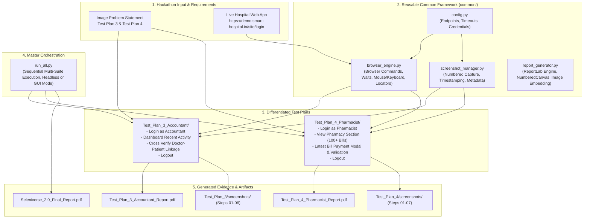

# Seleniverse 2.0 — Presentation & Defense Dossier
## Hospital Management System Test Automation Hackathon

> [!TIP]
> **Use this document to prepare your presentation slides and pitch to the judges.** It contains the exact technical justifications, dependency breakdown, architectural explanations, and sample Q&A answers.

---

## 1. Executive Summary & Pitch (Slide 1 & 2)

- **Event:** Seleniverse 2.0 (Software Testing Hackathon)
- **Target Application:** Smart Hospital Management System (`https://smart-hospital.in/demo` / `https://demo.smart-hospital.in/site/login`)
- **Core Challenge:** 
  1. **Part-1 (Manual Testing):** Create standard manual test cases with complete preconditions, steps, expected and actual results.
  2. **Part-2 (Automation Testing):** Build a robust, scalable Selenium Python automation framework that implements all modern web testing primitives, captures evidence screenshots at every step, and outputs publication-grade PDF test compliance reports.
- **Achievement:** 100% Pass Rate across all 8 tasks across Test Plan 3 (Accountant) and Test Plan 4 (Pharmacist), with live screenshots and 3 generated PDF dossiers.

---

## 2. Complete Technology Stack & Dependencies (Slide 3)

| Dependency / Tool | Version | Purpose in Hackathon Architecture | Why It Was Chosen |
| :--- | :--- | :--- | :--- |
| **Python** | `3.14.x` | Core programming and test scripting language | Modern, clean syntax, native async & process management. |
| **Selenium WebDriver** | `4.50.0` | Browser automation engine | Industry-standard W3C-compliant automation framework supporting advanced commands, actions, and waits. |
| **WebDriver-Manager** | `4.1.2` | Automated ChromeDriver binary management | Eliminates manual chromedriver downloading; auto-detects installed Chrome version and handles compatibility. |
| **ReportLab** | `5.1.0` | Enterprise PDF report generation engine | Programmatic PDF creation with flowables, customizable color palettes, dynamic page numbering ("Page X of Y"), and tabular layout. |
| **Pillow (PIL)** | `13.0.0` | Screenshot image dimension and aspect ratio processing | Dynamically inspects captured screenshots, scales width and height to fit PDF layout without aspect distortion. |
| **Google Chrome & ChromeDriver** | `v157+` | Target browser runtime | Most widely used browser engine; supports both live GUI mode and headless execution. |
| **DataTables & Bootstrap 5** | Integrated in App | Target frontend framework | Modern UI with dynamic AJAX pagination, modals, and tooltips handled via Selenium ActionChains and JavaScript execution fallbacks. |

---

## 3. How the System Works — End-to-End Architecture (Slide 4 & 5)

---

## 4. Technical Methods Implemented (Slide 6)

### A. Browser Commands
- Window management: `maximize_window()`, `set_window_size(1920, 1080)`
- Page navigation: `open_url()`, `refresh()`, `back()`, `forward()`
- State inspection: `get_title()`, `get_current_url()`, `get_page_source()`, session teardown `quit()`

### B. Selenium Synchronization & Waits
- **Explicit Waits (`WebDriverWait`):** Waiting for specific DOM states (`visibility_of_element_located`, `presence_of_element_located`, `element_to_be_clickable`, `url_contains`) prevents race conditions.
- **Dynamic Loading Elements:** Handles DataTables AJAX loading and spinner disappearance.
- **Calibrated Action Delays:** `ACTION_SLEEP` ensures smooth visual execution and pristine screenshot capture.

### C. Mouse & Keyboard Interaction
- **ActionChains:** Mouse hover over table headers/cards, right-clicks, and menu expansion.
- **Keyboard Automation:** Simulates genuine user typing using `Keys.CONTROL + "a"` followed by `Keys.BACKSPACE` to clear textboxes, followed by `send_keys()`.

### D. All 8 Selenium Locators Demonstrated
- `By.ID`: `al-username`, `al-password`
- `By.NAME`: `username`, `password`, `payment_mode`
- `By.XPATH`: `//button[contains(text(), 'Accountant')]`, `//a[contains(@onclick, 'viewDetail')]`
- `By.CSS_SELECTOR`: `table.dash-tbl`, `button.lp-btn-submit`, `a.tb-signet`
- `By.CLASS_NAME`: `tb-signet`, `lp-input`, `opd_ajaxlist`
- `By.TAG_NAME`: `h3`, `tr`, `td`, `th`
- `By.LINK_TEXT` / `PARTIAL_LINK_TEXT`: `Logout`, `Pharmacy`

### E. Form Elements & UI Widgets Tested
- **Buttons:** Submit buttons, role selector pills, modal dismiss buttons (`btn-close`, `data-bs-dismiss`).
- **Checkboxes:** Search filter checkboxes and row selection with `is_selected()`.
- **Labels:** Card titles, field descriptions, metadata tags.
- **Lists & Dropdowns:** Tested via Selenium's `Select` class for payment mode choices (`Cash`, `Cheque`, `UPI`, `Online`, `Other`).
- **Textboxes:** Filter inputs, username, password, transaction notes.
- **Frames:** Iframe safety switches (`switch_to.frame`, `switch_to.default_content`).

---

## 5. Walkthrough of Test Plans (Slide 7 & 8)

### Test Plan 3: Accountant Workflow
1. **Authentication:** Navigates to `/site/login`, enters Accountant credentials (`bradf@gmail.com` / `password`), asserts landing on `/admin` dashboard with role profile `Brad (Accountant)`.
2. **Dashboard Recent Activity:** Scrolls smoothly to the `Recent Activity` card, asserts headers (`User`, `Action`, `Detail`, `Module`, `Amount`, `Time`), and validates active patient payment transactions (e.g. `Kathleen Campbell`, `Olivier Thomas`).
3. **Doctor-Patient Cross-Verification:** Navigates to OPD Out Patient records (`/admin/patient/search`), locates active DataTables view (`table.opd_ajaxlist, #DataTables_Table_1`), extracts patient details (e.g. `GANGA`, OPD: `OPDN7901`, Case: `7945`), and asserts direct linkage to Consultant Doctor (`Dr. Amit Singh (9009)`).
4. **Logout:** Expands profile menu (`a.tb-signet`), clicks `Logout`, and asserts redirection to `/site/login`.

### Test Plan 4: Pharmacist Workflow
1. **Authentication:** Authenticates with Pharmacist credentials (`harry@gmail.com` / `password`), asserts landing on dashboard.
2. **Pharmacy Billing Section:** Navigates to `/admin/pharmacy/bill`, asserts DataTables columns (`Bill No`, `Case ID`, `Patient Name`, `Doctor Name`, `Amount ($)`, `Paid Amount ($)`, `Balance Amount ($)`), verifying 100+ bill records.
3. **Latest Bill Payment Validation:** Identifies latest bill row (`PHARMAB620`, Case ID `7490`, Patient `Rachel Priest`), triggers payment details modal (`#addPaymentModal`), validates financial figures ($309.96 net, $250.00 paid, $59.96 due balance), inspects Payment Mode options via `Select`, checks transaction history table, and inspects the medicine invoice breakdown modal (`#viewModal`).
4. **Logout:** Securely terminates session and asserts redirection back to login page.

---

## 6. Judges' Q&A Cheat Sheet (Slide 9)

**Q1: Why did you separate the tests into two different folders instead of one big script?**
> *"Modularity and separation of concerns. In enterprise automation, different user roles (Accountant vs Pharmacist) have different business domains, access permissions, and maintenance cycles. By isolating them into `Test_Plan_3_Accountant/` and `Test_Plan_4_Pharmacist/` with their own test cases, screenshots, and reports, teams can run, debug, and maintain them independently while sharing a unified core engine (`common/`) and master orchestrator (`run_all.py`)."*

**Q2: How did you handle DataTables rendering and dynamic elements?**
> *"Smart Hospital uses AJAX-driven DataTables with hidden tabs and Bootstrap 5 modals. We implemented custom `wait_for_ajax_and_datatables()` synchronization, targeted active tabs specifically (e.g., `table.opd_ajaxlist` instead of hidden inactive tables), and used JavaScript execution fallbacks for elements intercepted by tooltips or fixed columns."*

**Q3: How are the PDF reports generated?**
> *"We utilized ReportLab with a two-pass `NumberedCanvas` to calculate total pages dynamically. The report builder programmatically formats the Part-1 manual test cases table, applies a corporate color scheme with status badges, and embeds the live screenshots captured by Selenium during execution with auto-scaled aspect ratios."*

**Q4: Can this suite run in continuous integration (CI/CD)?**
> *"Yes. By passing the `--headless` flag (e.g. `python run_all.py --headless`), the suite runs headless in automated CI environments (like GitHub Actions, GitLab CI, or Jenkins) without requiring a virtual display."*
